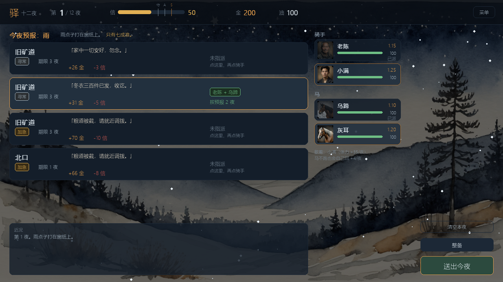

# 驿 · 十二夜

> 你是山口驿站的驿丞。十二个夜晚，把北边的战报送过山。

一个回合制资源调度游戏。**没有实时操作，没有战斗。**
核心是判断信息、承担风险、做取舍。

单局 15–25 分钟。Windows 桌面。


---

## 这个游戏在赌什么

黄昏时你会看到「今夜预报」。

**它只有七成准。**

预报说晴，你可能赌一把，把最快的骑手派去北口——那里只要一夜。
也可能保守一点，走旧矿道——又长又慢，但天气拿它没办法。

这个赌，每一夜做一次。



---

## 玩什么

### 三条资源

| 资源 | 说明 |
|---|---|
| **信** | 唯一的失败线。归零，驿就被撤了 |
| **金** | 买东西用 |
| **油** | 没油就没灯，夜里走得更慢 |

### 三条路

| 路线 | 距离 | 特点 |
|---|---|---|
| **北口** | 3 | 最快。但下雪就废 |
| **河渡** | 4 | 下雨涨水，走不动 |
| **旧矿道** | 5 | 又长又黑，但天气拿它没办法 |

### 骑手和马都是消耗品

骑手跑一趟扣体力，不派他出去就是「歇着」（+35/夜）。
马不跑也会自己回一点（+2/夜），但要恢复得快得花金喂料。

**体力和状态低的会显著减速**——所以「谁配谁」是有讲究的。

### 胜负

十二夜之后：

| 最终信 | 结果 | 评价 |
|---|---|---|
| ≥ 80 | 守住了 | **S** |
| 70–79 | 守住了 | A |
| 60–69 | 守住了 | B |
| 40–59 | 撑过了，但信已经薄了 | C |
| 20–39 | 没人再指望这条驿路 | D |
| 0–19 | 同上 | E |

**信归零** → 中途被撤，直接失败。

---

## 第一次玩，先记住这四件事

1. **人派出去不是当夜就回来。** 路程几夜，他们就占用几夜，
   这段时间里不在列表里、也派不了别的信。
2. **抵达那夜仍算占用。** 要等**下一夜**才能再派——算排班时多留一夜。
3. **天气每夜都会变。** 预报只有七成准，「预计 N 夜」是按预报算的，
   变天就会更久。
4. **路上会碰到事。** 顺风、迷路、落石、遇劫，概率固定，
   你能靠「多留余量」对冲。

**核心决策**：一封「还剩 1 夜余量」的高价值信要不要接？
接，可能多拿很多信；不接，稳但慢。这个权衡就是整个游戏。

---

## 怎么开始

### 下载版

去 [Releases](../../releases) 下载 `yi-twelve-nights-v0.5.0-win64.zip`，解压后双击 `驿.exe`。

**这一版是新手的量**：第一次玩建议先看标题页的「怎么玩」，它把在途占用、天气、事件都讲清楚了。十二夜，信到 60 就算守住。

不需要装 Python，不需要联网。

### 从源码跑

```bash
pip install pygame-ce numpy
python main.py
```

参数：

```bash
python main.py --seed 42        # 固定随机种子（复盘用）
python main.py --assets-check   # 检查素材和字体
```

---

## 操作

| 操作 | 说明 |
|---|---|
| 点一封信 | 选中 |
| 点一个骑手 | 派给他（再点取消） |
| 点一匹马 | 换马 |
| 「送出今夜」/ 空格 / 回车 | 推进一夜 |
| 「整备」 | 买马、雇人、喂料、添油 |
| 「清空本夜」 | 撤销当晚所有指派 |

**没有指派的骑手会歇一夜，体力 +35。**

---

## 对局日志

**每局结束会自动写一份完整日志到 `logs/`**（exe 旁边的 `logs\`）：

```
logs/
  run-20261123-233847-win.txt    人类可读
  run-20261123-233847-win.json   机器可读
```

里面记着每一夜的预报 vs 实际、拒收了哪几封、谁跑哪条路、
需要几夜 vs 期限几夜、为什么失败、赏罚多少。

**种子也在里面**，可以 `python main.py --seed N` 重放。

---

## 文档

| 文档 | 内容 |
|---|---|
| [GDD](docs/GDD.md) | 设计文档：目标、系统、数值、风险 |
| [开发日志](docs/DEVLOG.md) | 决策记录，包括做错的决策 |
| [问题清单](docs/ISSUES.md) | 已解决 15 个 / 未解决 7 个 / 疑似 2 个 |
| [后续计划](docs/ROADMAP.md) | 打算加什么、明确不做什么 |
| [评审指北](docs/REVIEW.md) | 给外部评审者：我最想被质疑的五个决定 |

---

## 已知的取舍

这个项目有意**不做**几件事：

- **不做实时** —— 目标玩家要的是思考时间，不是反应速度
- **不做战斗** —— 战争只作为信的背景存在。你只看到纸和雪
- **不做无限模式** —— 十二夜的固定长度是张力的来源
- **不做数值通胀** —— 金的总量有限，自然会形成选择

完整理由见 [GDD](docs/GDD.md) 第 1.3 节。

---

## 技术

| 层 | 选型 |
|---|---|
| 语言 | Python 3.14 |
| 图形 | pygame-ce 2.5.8 |
| 音频 | numpy 合成（无外部音频文件） |
| 美术 | 本机 ComfyUI + RealVisXL_V4.0 生成 |
| 打包 | PyInstaller |

**核心逻辑与渲染完全分离**：`relay/core/` 不 import pygame，可以无头跑测试。

### 目录

```
relay/
  core/       纯逻辑（balance / models / sim / runlog）
  ui/         渲染（theme / art / widgets / fx / scenes / app）
  audio/      音效（synth / player）
  assets/     美术 + 音效
tests/        25 个单元测试
tools/        素材生成、平衡模拟、策略搜索
docs/         文档
```

### 开发

```bash
python -m unittest discover -s tests -v    # 测试
python tools/sim_balance.py -n 500         # 平衡模拟（默认 smart 口径，可选 -s base）
python tools/gen_assets.py --list         # 看素材清单
python build.py                           # 打包（注意：`--clean` 单独用时只清不打包）
```

`tools/gen_assets.py` 需要本机跑着 ComfyUI（默认 `127.0.0.1:8188`）。

---

## 验证

> 2026-11-25（v0.5.1）重跑。**口径必须写清**：下面这组数是
> `python tools/sim_balance.py -n 500`（默认 smart 策略：会算账 + 只接余量≥1 的信）
> 跑出来的，不是新手难度。换成 `-s base`（会算余量、但买马不保护油钱）是
> 达标 48% / S 16%。详见 [ISSUES.md](docs/ISSUES.md) S-18。

| 项 | 结果 |
|---|---|
| 单元测试 | **91 项全过** |
| 平衡模拟（500 局，smart） | 达标 71.2%，S 27.2%，终局信中位 68，送达率中位 80% |
| 平衡模拟（500 局，base） | 达标 47.6%，S 15.6% |
| 派遣顺序无关性 | 300 种子 × 4 油量 × 2 顺序 = 2400 组，零分歧 |
| 手动打满一局 | **S**（种子 17，信 83，送达率 89%） |
| 存档往返 | 字段全一致、无 id 撞号、能继续打、坏档不崩 |
| exe 真机验证 | 标题页帮助五节、第 1 夜零余量信、第 5 夜八百里、12 夜结算页、关窗口重开「继续」、主界面「存盘退出」→ 标题页出现「继续」并复原状态 |

### 规则正确性专项

v0.3.0 由两份外部评审驱动，逐条核实后修复了 11 项规则问题，
其中 **7 项是「打满一局才会暴露」的类型**。详见 [ISSUES.md](docs/ISSUES.md)
的「已解决 · 外部评审发现」一节。

一个仍在记录中的设计问题：**目前「纯保守」策略比「赌预报」S 率高 14 个百分点**，
核心机制尚未真正生效。根因见 [ROADMAP.md](docs/ROADMAP.md) 第 1 条。

---

## 素材来源

- **美术**：本机 ComfyUI + RealVisXL_V4.0 生成，程序化提示词，无版权素材
- **音效**：numpy 合成，本仓库代码生成
- **字体**：系统字体，不随包分发
- **代码**：全部自写

---

## License

MIT，见 [LICENSE](LICENSE)。
